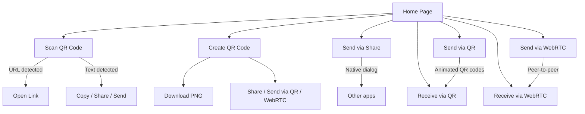
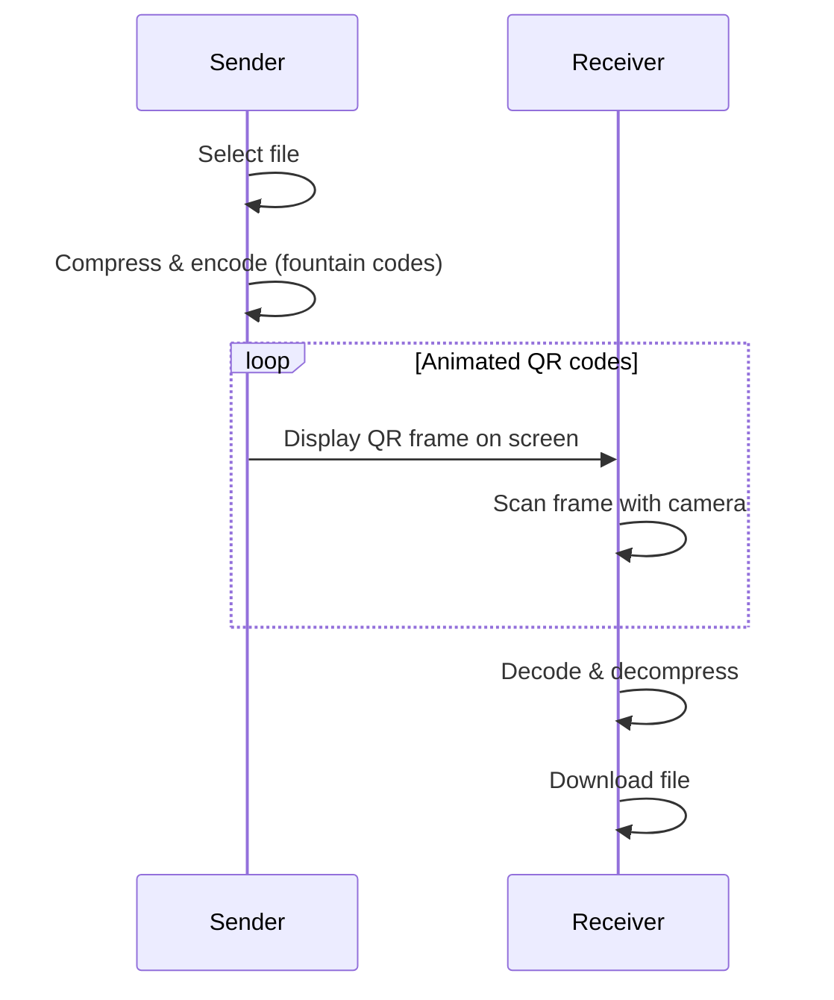
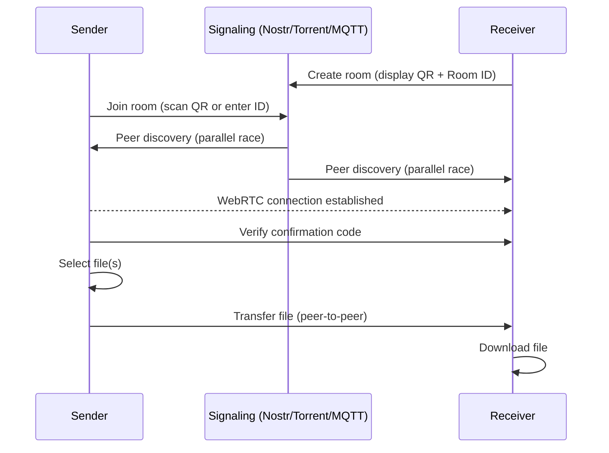

# QRShare — User Guide

## What is QRShare?

QRShare is a web application that lets you:

1. **Scan a QR code** using your device's camera
2. **Create a QR code** from any text or web address
3. **Share a file or text** to any app via the native share dialog
4. **Send a file or text** to another device via animated QR codes (no internet required)
5. **Send a file or text** peer-to-peer via WebRTC (internet required)
6. **Send a short text or small file** as sound, from speaker to microphone (Audio — Experimental, no internet or camera required)

The application runs directly in your browser with nothing to install. It is available at:
**https://s-celles.github.io/QRShare/**



---

## Home Page

When you open the application, you see two sections:

### QR Utilities (top)

Two buttons for everyday QR tools:

- **Scan QR Code** — Read a QR code with your camera
- **Create QR Code** — Generate your own QR code

### File Transfer (bottom)

Five buttons for transferring files between devices:

- **Send (Share)** — Share files via the native share dialog (messaging, email, cloud storage, etc.)
- **Send (QR)** — Send a file via animated QR codes
- **Receive (QR)** — Receive a file by scanning animated QR codes
- **Send (WebRTC)** — Send a file peer-to-peer over the network
- **Receive (WebRTC)** — Receive a file peer-to-peer over the network

Two experimental groups follow the QR Code group: **CIMBAR (Experimental)**, a
high-speed color barcode, and **Audio (Experimental)**, which transfers small
payloads as sound (see *Experimental Audio Transfer* below).

The WebRTC group also offers the **Paste board (Experimental)**, an anonymous
room of signed texts and files (see *Experimental Paste Board* below).

---

## Scanning a QR Code

1. Tap **Scan QR Code**
2. Tap **Start Scanning** — your browser will ask for camera permission
3. Point the camera at a QR code
4. The content is displayed automatically:
   - If it is a web address, it appears as a clickable link
   - Otherwise, the text is shown and you can copy it with the **Copy to Clipboard** button
5. As soon as content is received, scanning stops and the camera area disappears

**Information displayed while scanning**: active camera name and resolution. If you have multiple cameras, a dropdown lets you choose which one to use.

### Passkey Sign-in Codes (FIDO)

When you sign in to a website on a computer with a passkey kept on your phone, the
computer shows a QR code starting with `FIDO:/`. QRShare recognises it and shows a
**Passkey sign-in code** card: whether the computer asks to sign in or to create a
passkey, and when the code was made (a warning appears if it is more than five
minutes old and has most likely expired).

QRShare cannot sign you in itself: a web page cannot use your phone's passkeys.
Scan the code with the camera or QR reader of the phone that holds the passkey,
next to the computer — the phone checks over Bluetooth that it is close. Where the
system handles these codes (for example on Android), **Open with this device**
hands it over.

For your safety, QRShare offers no copy, share or send button for these codes:
**never forward a passkey code** to another person or device.

---

## Creating a QR Code

1. Tap **Create QR Code**
2. Type your text or paste a web address into the text area
3. The QR code is generated instantly and updates with every change
4. Adjust the parameters if needed:
   - **Template** — Choose between **Plain Text**, **Wi-Fi Network** (`WIFI:S:...`), or **Contact Card** (**MECARD** compact or **vCard 3.0** standard).
   - **Error Correction** — Error correction level (L, M, Q or H). A higher level makes the QR code more resistant to damage, but reduces the amount of data it can hold.
   - **Version** — In Auto mode, the application picks the smallest size that fits. In Manual mode, you choose a version from 1 (small) to 40 (very large).
5. The **Payload** counter shows how many bytes your text uses compared to the maximum capacity.
6. For a Wi-Fi QR code, tap **Print Wi-Fi Sign** to display and print a clean Wi-Fi access card.
7. Tap **Download PNG** to save the QR code as an image.

If the text is too long for the selected version and error correction level, an error message is displayed.

### Local Network Peer Discovery (Zero-QR Transfer)

On the home screen, QRShare automatically displays the **"Nearby Devices on Local Network"** card whenever other devices on the same Wi-Fi/LAN network have QRShare open:
- **Zero-scan detection**: Devices automatically announce their presence via WebRTC signaling without requiring any QR code scan.
- **Direct transfer**: Click **Send** next to a discovered device to send a file or text message directly.
- **Receiver prompt**: The receiver receives an invitation prompt (*Accept / Decline*). Once accepted, the transfer starts immediately over a direct WebRTC DataChannel.
- **Privacy settings**: Local discovery can be enabled/disabled and custom device names can be configured in **Settings**.

---

## Preparing a Transfer and Inviting the Receiver

This workflow lets the sender prepare the content and open QRShare on the correct receiver screen before transmitting any payload data.

1. On the home screen, tap **Prepare a transfer**.
2. Choose **File** or **Text**, then select one or more files or enter the text.
3. Choose the transfer policy:
   - **Air-gapped only** — only air-gapped modes (static QR, animated QR, experimental CIMBAR, or experimental audio) are offered. WebRTC and system sharing are excluded regardless of payload size.
   - **Prefer air-gapped** — an optical mode is recommended, while network modes remain available.
   - **Any mode** — QRShare may recommend WebRTC when the content does not fit in a static QR code.
4. Keep the recommended mode or choose another mode allowed by the policy. Size is only one criterion; the selected policy is always respected.
5. First show the invitation QR code to the receiver. It contains only a link to QRShare and opens the matching receive screen; it does not contain the file.
6. When the receiver is ready, tap **The receiver is ready — start sending**.

When several files are selected, QRShare automatically bundles them into a transfer ZIP archive and extracts them on the receiver. The selection is limited to 50 MB total; CIMBAR is offered up to approximately 33 MB and audio up to 8 KB; for several files, these limits apply to the size of the ZIP archive. If the content grows beyond the selected mode's limit, the mode switches back to the recommended one. Audio is recommended only when the device has no camera and the content is at most 1 KB.

### Passing Text Through a URL

An application can open the send chooser directly with a URL such as:

```text
https://s-celles.github.io/QRShare/#/send?data=Hello&policy=prefer-airgap
```

`data` contains URL-encoded text. `policy` accepts `airgap`, `prefer-airgap`, or `any`. If the policy is absent or invalid, QRShare defaults to preferring air-gapped transfer. This mechanism is intended for text; files are handed over as described below.

### Exchanging Files with Other Web Apps

Web applications such as [Progressive Web Office](https://github.com/s-celles/progressive-web-office) can hand files to QRShare, and get received files back, directly in the browser (app handoff protocol, version 1):

- **App → QRShare**: the app opens `#/send?handoff=1&policy=...`. QRShare shows *Waiting for the file from the application…*, receives the file, and opens the transfer chooser with *Received from <app>*. Nothing is sent until you pick a transfer mode.
- **QRShare → App**: the app opens the receive screen with a `return` parameter, for example `#/receive/qr?policy=airgap&return=https%3A%2F%2Fexample.org%2Fapp%2F`. Once a file is received, an **Open in <host>** button delivers it to that application only.

Files shared to QRShare through the system share sheet also open in the transfer chooser.

For developers: the two windows exchange `{ type: "qrshare-handoff", version: 1, action }` messages with `postMessage` — `ready` (receiving window → its opener), `file` (`name`, `mimeType`, `data` as an `ArrayBuffer`, posted to the exact origin) and `received`. Files are limited to 200 MB. Applications can check support beforehand: QRShare's `manifest.webmanifest` lists the protocol versions it speaks in `qrshare_handoff.versions`.

**Version 2** adds two optional parameters, announced in the manifest as `"versions": [1, 2]` and `"features": ["mode", "reply-opener"]`:

- `mode=animated-qr` (or `cimbar`, `webrtc`, `share`) on `#/send?handoff=1`: once the file is received, QRShare goes straight to that transfer mode, when the policy allows it, instead of showing the chooser.
- `reply=opener` on `#/receive/...?return=<app>`: after the user clicks *Open in …*, QRShare posts the `file` message back to the window that opened it, to the origin of `return` only, then closes. If that window is gone, it falls back to opening a new one, as in version 1.

---

## Sharing Files via Native Share

This method uses your browser's built-in share dialog to send files to any compatible app (messaging, email, cloud storage, etc.).

1. Tap **Send (Share)**
2. Drop files or click to browse and select one or more files
3. The native share dialog opens — choose the target app
4. The file is handed off to the selected app

**Note:** This feature requires a browser that supports the Web Share API (most mobile browsers and some desktop browsers). If unsupported, an error message is displayed.

---

## Sending a File via QR Code (no internet)

This method requires **no internet connection**. The file is transmitted optically, from screen to camera.



**On the sending device:**
1. Tap **Send (QR)**
2. Drop a file or click to choose one (50 MB maximum)
3. Choose an encoding mode:
   - **High Speed** — Larger QR codes, suited for good scanning conditions
   - **Balanced** — Trade-off between capacity and reliability
   - **High Reliability** — Smaller QR codes, very reliable
4. An animated QR code appears on screen — do not close the page
5. Adjust transfer parameters if needed:
   - **Frame Rate** slider (1–30 FPS, default: 10) — Lower values give the camera more time to scan each frame
   - **Block Size** slider (50–1000 bytes, default: 250) — Smaller blocks produce simpler QR codes that are easier to scan

**On the receiving device:**
1. Tap **Receive (QR)**
2. Tap **Start Scanning**
3. Point the camera at the animated QR code on the sending device
4. The progress bar shows transfer progress, along with transfer speed and elapsed time
5. Once complete, the file downloads automatically

---

## Sending a File via WebRTC (with internet)

This method uses a network connection but the file goes directly from device to device, without passing through a server.

Peer discovery uses multiple signaling strategies in parallel (Nostr relays, BitTorrent trackers, MQTT brokers) for improved reliability. The first strategy to discover the peer wins, and the others are cancelled.



**On the receiving device:**
1. Tap **Receive (WebRTC)**
2. A QR code is displayed with a Room ID

**On the sending device:**
1. Tap **Send (WebRTC)**
2. Scan the receiver's QR code or enter the Room ID manually
3. Verify that the **4-digit confirmation code** matches on both devices
4. Select the file(s) to send
5. The transfer starts automatically

---

## Navigation Bar

At the top of every page:

- **QRShare** (left) — Return to the home page
- Version and build hash (next to the title) — Open the About window
- Theme button — Cycle between ◐ Auto (follows the system setting), ☀ Light and ☾ Dark
- **?** — This user guide
- Book icon — The full documentation (this guide, how QRShare works, connectivity, collaborative editing, architecture, development)
- **i** — About window: version, links, QR code of the app
- Gear icon — Settings (theme, language, WebRTC settings)
- **← Back** — Return to the home page (present on every sub-page)

---

## WebRTC Settings

Access via **Settings → WebRTC Settings** (or directly at `/#/settings/webrtc`).

### Connection Mode

- **Parallel** (default) — All enabled strategies are tried simultaneously. The first to establish a connection wins. This is the fastest approach.
- **Sequential** — Strategies are tried one by one in the configured order. If one fails (10-second timeout), the next is tried. This is useful if you want to prefer a specific strategy.

### Signaling Strategies

QRShare uses multiple signaling strategies to help two devices find each other for WebRTC file transfer:

| Strategy | Protocol | Description |
|----------|----------|-------------|
| **nostr** | Nostr relays | Decentralized relay network |
| **torrent** | BitTorrent trackers | WebTorrent tracker protocol |
| **mqtt** | MQTT brokers | Lightweight messaging protocol |

For each strategy you can:

- **Enable/disable** it using the checkbox
- **Reorder** it using the up/down arrows (order matters in sequential mode)
- **Edit relay URLs** (one per line) to use custom servers

At least one strategy must remain enabled. Leave relay URLs empty to use library defaults.

### Reset

Click **Reset to Defaults** to restore all WebRTC settings to their original values.

---

## Settings Export / Import

You can back up and restore all QRShare settings (theme, language, and WebRTC configuration) using TOML files.

### Export

1. Go to **Settings**
2. Click **Export Settings (TOML)**
3. A `qrshare-config.toml` file is downloaded

### Import

1. Go to **Settings**
2. Click **Import Settings (TOML)**
3. Select a previously exported `.toml` file
4. All settings are applied immediately

This is useful for sharing your configuration across devices or restoring settings after clearing browser data.

---

## Experimental CIMBAR Transfer

CIMBAR is a high-speed, air-gapped optical mode using matrices of colored
symbols. Select **Send (CIMBAR — Experimental)** on the sender and **Receive
(CIMBAR — Experimental)** on the receiver. The **Prepare a transfer** workflow
can also create the matching invitation and preload the sender's file.

The libcimbar browser decoder is still beta. Use good lighting, maximize the
matrix on the display, and keep standard animated QR as a fallback. The CIMBAR
protocol limit is approximately 33 MB after compression. Once reconstruction
finishes, the camera area disappears. A file can then be downloaded or shared
through the system dialog. Text prepared in QRShare is displayed directly with
the same actions as other receivers: copy, download as `.txt`, and share.

---

## Experimental Audio Transfer

Audio sends a short text or a small file **as sound**: the sender plays tones
through its loudspeaker and the receiver decodes them from its microphone. No
network, camera or line of sight is needed, only two devices within hearing
range. It is useful when cameras are unusable (no camera, a broken lens, a
screen that cannot be shown) for things like Wi-Fi passwords, keys, short notes
or small configuration files.

### Usage

1. On the receiver, tap **Receive (Audio — Experimental)**, then **Start
   listening**, and allow the microphone. The receiver detects the sender's
   profile automatically.
2. On the sender, tap **Send (Audio — Experimental)**, choose **File** or
   **Text**, and press **Play**. Audio can also be picked in the transfer chooser
   and in **Prepare a transfer**, whose invitation QR code opens the audio
   receive screen on the receiver. A link with `autostart=1` starts listening
   right away; if the browser needs a tap first, a large **Tap to start
   listening** button appears.
3. The sender plays packets continuously. Each packet carries a different piece
   of a fountain code, so missed or damaged packets do not matter: the receiver
   finishes as soon as it has heard enough of them. Press **Stop** once the
   receiver shows the result. If you change the profile or codec on the sender
   while the receiver is listening, the receiver follows the new transmission of
   the same content automatically.

The receiver shows the input level, a **Signal detected** badge, the packets
decoded and rejected, the unique symbols received against those needed, and the
effective rate. When the transfer completes, the microphone is released and the
result appears as for the other receivers: the SHA-256 check, text displayed
directly, or a file with preview, **Download**, **Share** and **Open in …**;
content received from an older QRShare version encrypted with a password shows the unlock card.

### Profiles and speeds

| Profile | Band | Approx. net rate | When to use |
|---|---|---|---|
| **Robust** (default) | 1.5–6.3 kHz, audible | about 22 bytes/s | Normal use, phones and laptops |
| **Fast** | 1.5–6.3 kHz, audible | about 53 bytes/s | Quiet room, devices close together |
| **Ultrasonic** (Advanced, less reliable) | 18.5–19.8 kHz, half level, hard to hear for most adults | about 5 bytes/s | When audible tones are a problem; keep the volume around 50–70% (louder adds audible distortion); many speakers and microphones attenuate it |

For example, a 1 KB text compressed to about 600 bytes takes about half a
minute with Robust and about 13 seconds with Fast. The sender shows the
estimated minimum duration before you press Play. Under **Advanced**, the
sender can also choose the fountain codec: **Auto (Wirehair)**, the default
and most efficient, or **LT (compatibility)** if the receiver reports that
Wirehair cannot be loaded.

### Size limits

Audio is suitable for content up to **1 KB**. Up to the hard maximum of **8 KB**
it remains available but is slow (several minutes); above 8 KB the sender
refuses and suggests animated QR codes or CIMBAR.

### Tips

- Set the sender's media volume to 70–100%.
- Keep the devices 10–50 cm apart in a quiet room.
- Do not use a Bluetooth speaker or headset (their codecs distort the tones).
- On iPhone, QRShare asks the system to play audio even with the silent switch
  on, where Safari supports it.
- If the receiver shows **Too quiet**, move closer or raise the volume; if it
  shows **Clipping**, lower the volume.

### Limitations and privacy

- It is a one-way broadcast: the sender cannot know when the receiver is done.
- Some browsers (notably on iOS) may still apply voice processing to the
  microphone, which lowers reliability.
- Sound is a broadcast: anyone within hearing range, or any recording device,
  can capture the transfer. For sensitive content, see *Encrypted (sealed)
  transfers* below. The microphone is used only while the receive screen is
  listening, and no audio is stored.

### Encrypted (sealed) transfers

Tick **Encrypt with password** on the audio sender and give the password to the
receiver by another means (spoken, written, never through the same sound
channel). The transfer is then **sealed**: nothing readable goes on the air.

- The content, the file name, its exact size and whether it is a text or a file
  are all encrypted (AES-256-GCM, key derived from the password with
  PBKDF2-SHA256).
- The size sent is rounded up to the next multiple of 256 bytes, so a listener
  only learns a size range; small transfers take a few seconds longer.
- Each transfer uses a random identifier, which cannot be linked to its content.

On the receiver, type the password in the **Password** field before pressing
**Start listening**, or later: when a sealed transfer is detected, the receiver
asks for the password and **keeps listening** meanwhile, so nothing is lost. A
wrong password is reported as soon as the first metadata packet is heard;
correct it and press **Unlock**. When the transfer completes, the content is
shown already decrypted.

What stays visible: how long the sender plays, and therefore the size range.

---

## Experimental Audio Sessions (chat over sound)

An audio session connects two devices (or a small group) **over sound**, like a
WebRTC connection but with no network at all. Once connected, participants chat
with short messages and send files, everything encrypted.

1. On one device, open **Audio session — chat (Experimental)**, keep or change
   your name, choose a profile (Fast by default; Robust for noisy rooms;
   Ultrasonic, barely audible but less reliable) and press **Create**. The device
   announces the session with short beeps every few seconds.
2. On the other device, open the same screen and press **Join**. The sessions
   heard nearby are listed; press **Join** next to the right one.
3. Both screens show the members and a **4-digit verification code**. Check that
   the code is the same on every device: if it differs, someone may be in the
   middle — leave the session.
4. Type messages (up to 180 bytes each). Your messages show **✓ 0/1** while
   waiting, then **✓✓** once everyone received them, or **✗ not delivered**
   after several attempts. A file can be sent to the session with **Send a
   file**; members receive it automatically and it appears in the conversation.

How it works, in short:

- **Encryption without a password to share**: when joining, the two devices
  exchange public keys (P-256) over sound and derive a common key; the host
  then hands over the session key. Every message and file is encrypted
  (AES-256-GCM). The verification code is computed from the keys, so a device
  relaying the exchange would show a different code.
- **One device speaks at a time**: each device waits for silence and a short
  random delay before sending, like a walkie-talkie. Messages that are not
  acknowledged are sent again automatically.
- **Several participants**: up to 6 devices can join the same session; every
  message reaches everyone and the code is the same on every device. Every
  device must hear every other one (no relaying yet).
- A member silent for more than 75 seconds is shown as *away*; **Leave the
  session** tells the others.

The screen estimates the time: under each profile when creating a session, next to
the byte count while typing, and in the conversation when a file is sent. Expect,
until a short message shows ✓✓, about 5 seconds with Fast, 7 seconds with Robust
and 17 seconds with Ultrasonic; a 1 KB file takes about 1 minute with Fast. Keep both screens open, the devices within a few metres
(less than 1–2 m for Ultrasonic), and the media volume high. If a **Tap to enable
the sound** button appears, tap it: the browser keeps the sound muted until then.
While joining, the screen shows how many requests were sent; if the count grows
without a connection, raise the volume and bring the devices closer. On iPhone, recording
and playing at the same time may route the sound to the earpiece at a lower volume.

---

## Experimental Paste Board (anonymous, with proofs of existence)

The paste board is a room where people share short texts — plain text or
Markdown — with images and files, under a **session pseudonym**. It needs a
network (the same signaling relays as WebRTC). **Nothing is stored anywhere**: a
paste lives only in the memory of the connected devices, and disappears once no
connected device holds it.

### Creating and joining a board

1. Open **Paste board (Experimental)** in the WebRTC group of the home screen and
   press **Create**. The board shows a 16-character **room code** (for example
   `7KQ2-M9XD-4TPA-WZ3H`) and, on demand, a **QR code**.
2. Others either scan the QR code (with **Scan** or any camera app opening
   QRShare), or press **Join** and type the code. Case, dashes and spaces do not
   matter, and `I`/`L` read as `1`, `O` as `0`.
3. The header shows the number of connected peers. **Leave the board** (or
   closing the page) drops the board, its attachments and keys from this device.

Anyone who knows the room code can read and post: share it only with the
intended participants. When the board is opened from a link, the code is removed
from the address bar.

### Posting

- Choose **Markdown** (default) or **Plain text**, write, and use **Preview** to
  see the Markdown as others will. A paste holds up to 16 KiB of text; you can
  post at most once every 3 seconds.
- **Attach files** (up to 4 per paste) with the button, by pasting from the
  clipboard or by drag and drop. In Markdown, a reference such as
  `` is inserted where the cursor is.
- Every paste is **signed** with a key created for this board only, unrelated to
  your device identity and contacts. Others see you as a pseudonym and colour
  (for example *Swift Crimson Falcon*) followed by 8 hex digits of the key
  fingerprint; your own pastes are marked **you**.
- The time shown is **declared by the author's device clock** and not verified;
  the time this device received the paste is shown next to it, and a paste
  declared more than 5 minutes ahead is flagged *dated in the future*.

### What is protected, what is not

- **Images** (PNG, JPEG, WebP, GIF) are re-encoded on your device before being
  attached: orientation applied, downscaled to at most 2048 px, saved as WebP (or
  PNG/JPEG), the first frame only for GIFs, and every remaining metadata chunk
  removed. No EXIF, GPS position, camera model, ICC profile or text comment
  leaves the device. Images can be up to 1.5 MiB after re-encoding.
- **Other files** (up to 5 MiB) are sent **unchanged**: a PDF or office document
  can name its author, a video can carry camera data. QRShare warns you and does
  not remove it.
- Received content comes from anonymous participants, so QRShare shows it
  cautiously: Markdown is rendered without any HTML, script or style; links open
  in a new tab only for `http`, `https` and `mailto` addresses; **remote images
  are never loaded** (a chip names the site instead); only real raster images are
  shown inline, and only up to 2048 × 2048 pixels; audio and video play only when you press **Play**; everything
  else — SVG, HTML, PDF, archives, programs — is a **download chip** and is never
  opened by QRShare. Executable and script files show a warning and ask for
  confirmation before downloading.
- A board holds at most 500 pastes, 4 MiB of text and 32 MiB of attachments, and
  50 pastes or 8 MiB of attachments per author; attachments count only once
  they have arrived. Devices sending invalid data are ignored after 5 errors.
  Anyone with the room code can still flood the board under many pseudonyms: it
  then refuses new pastes but keeps the existing ones.

### Exporting

**Export** saves a readable copy while you can see the board:

- **ZIP** (default when there are attachments or proofs): `board.md`, the
  attachments under `attachments/`, and for every paste its statement, signature
  and proof under `proofs/`. The statements contain a one-way tag of the room:
  anyone holding them can tell that the pastes come from the same board.
- **Markdown only**: `board.md`, where attachments are replaced by a placeholder
  giving their name and SHA-256.

Each paste starts with a header (pseudonym, fingerprint, declared time in UTC,
format, paste id, source SHA-256, signature, OpenTimestamps status, attachments).
Markdown pastes are quoted and their raw HTML escaped, plain-text pastes are in a
code block, so no paste can change the structure of the export. The room code and
keys are never exported.

### Proving that a paste existed (OpenTimestamps)

Any participant can obtain a **proof of prior existence** of a paste with
[OpenTimestamps](https://opentimestamps.org):

1. Press **Timestamp (OpenTimestamps)** under a paste. The first time, QRShare
   explains what is sent: a blinded 32-byte hash of the paste — never its
   content — to public calendar servers, which also see your IP address and the
   time of the request.
2. The proof is **pending** at first. If you wrote the paste, it is signed with
   your session key and shared with the board (*proof shared by the author*);
   only the author can share a proof, so a proof sent by anyone else is
   refused. If someone else wrote it, your proof stays on your device (*your
   own proof*): you see it next to the author's, and can download and export
   it, but it is never sent. A few hours
   later, once a calendar has anchored it in Bitcoin, press **Upgrade the
   proof**: the status becomes *Bitcoin attestation claimed (block N), not
   verified*. **Check in Bitcoin** compares the proof with that block through a
   block explorer; once it matches, the status becomes *anchored in Bitcoin*.
   Until then, a Bitcoin attestation — received from a calendar or from another
   participant — is only a claim, also in exports. Calendars still pending are
   listed next to it, and **Upgrade the proof** stays available while one of
   them is pending.
3. Under **Downloads**, save the statement (`paste-<id>.statement`), its
   signature (`.sig`), the proof (`.statement.ots`) and the source.

The proof covers the **statement**: the source text exactly as written, the
SHA-256 of every attachment, the author key and the declared time. It shows that
the statement existed **no later than** the Bitcoin block; it says nothing about
who wrote it nor whether the declared time is true.

To check a proof later, without joining a board, open **Check a proof** from the
paste board screen and pick the statement, its `.ots` and optionally its `.sig`
and attachment files: QRShare checks the digest, the signature and the
attachments, shows the paste, replays the proof, can upgrade it, and lets you
download the upgraded `.ots`. With the reference client, the trust-minimised
check uses your own Bitcoin node:

```bash
ots upgrade paste-<id>.statement.ots
ots verify paste-<id>.statement.ots   # needs the statement file next to it
```

---

## Sharing Text Messages

All three transfer methods (Share, QR, WebRTC) support sending text messages in addition to files. When entering a sender view, a **File / Text** toggle at the top lets you choose what to send.

### Sending Text

1. Select any sender mode (Share, QR, or WebRTC)
2. Switch the toggle from **File** to **Text**
3. Type or paste your message into the text area (up to 100,000 characters)
4. The character count is displayed below the input
5. Tap the send/share button

For QR mode, short text is encoded as a standard QR code. Longer text uses the same fountain code pipeline as files.

### Receiving Text

When another device sends a text message, the receiver automatically detects it and displays the text inline instead of triggering a file download. Three action buttons are available:

- **Copy to Clipboard** — Copies the text to your clipboard
- **Download as File** — Saves the text as a `.txt` file
- **Share** — Opens the native share dialog (if supported)

### Sharing Text from Other Apps

If QRShare is installed as a PWA, you can share text from other apps directly to QRShare via the system share sheet. QRShare will open in sender mode with the text pre-filled.

---

## Frequently Asked Questions

**Does the application need internet?**
No for QR code, CIMBAR (optical transfer) and audio (sound) modes. Yes for WebRTC mode. The Scanner and Creator tools work offline after the first load.

**Which browsers are supported?**
Any modern browser (Chrome, Firefox, Safari, Edge) on desktop or mobile.

**Do my files go through a server?**
No. In QR mode, the transfer is purely optical. In WebRTC mode, the file goes directly from one device to the other.

**Can I install the application?**
Yes. QRShare is a Progressive Web App (PWA): your browser can offer to install it on your home screen for offline access.

**Why does a received Markdown file look different from its source?**
A received `.md` file comes from someone else, so its preview is rendered cautiously, like a paste on the paste board: HTML in it is shown as text, only `http`, `https` and `mailto` links are clickable (they open in a new tab), and images from websites are never loaded — a chip names the site, and opens the image only if you click it. **Download** always gives you the file exactly as received.
